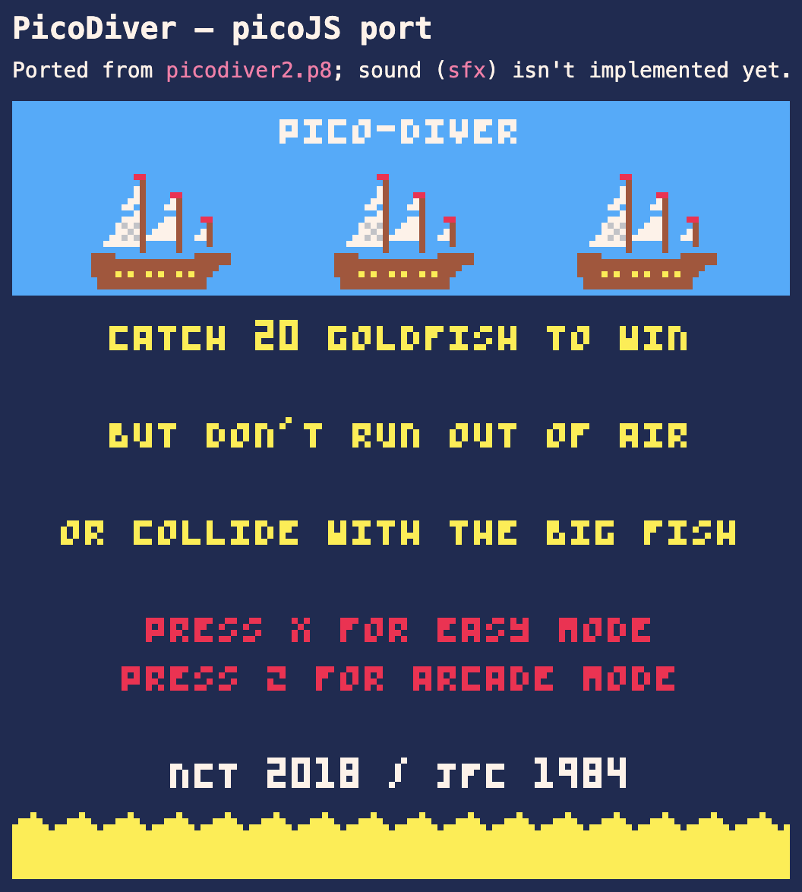

# Pico-JS Javascript Game library

**Current version: 1.0.1**

A simple JavaScript game library, which makes it easy to create canvas-based games playable through a web browser.

It is inspired by Pico-8, a Lua-based virtual game console and game creation IDE, and can be used to port Pico-8 games to JavaScript.



## Getting the library

There's a single file: **`picoJS.js`**, in the repo root. `picoJS.js` is continuously updated in place — version history lives in git tags and [CHANGELOG.md](CHANGELOG.md), not as parallel per-version files.

```html
<script src="picoJS.js"></script>
<script src="mygame.js"></script>
```

```js
// mygame.js
function _init()   { /* ... */ }
function _update() { /* ... */ }
function _draw()   { cls(1); spr(0, 64, 64); }

picoJS.run({
    sprites: "sprites.png",
    init:   _init,
    update: _update,
    draw:   _draw
});
```

## Porting a real Pico-8 cart

`tools/p8-to-js.js` converts a `.p8` cart's map, sprite flags, and sprite pixel data into a JS data module `picoJS.run()` can load directly (`node tools/p8-to-js.js mygame.p8 mygame-data.js`). 

It doesn't touch `__gfx__` as an image (you still need an actual spritesheet PNG for `spr()`/`sspr()` to draw with) or `__lua__` at all — porting the actual game logic from Lua is a manual, cart-by-cart job. Sound `sfx` conversion is not supported.

`games/picodiver/` is a port of an existing Pico-8 cart, used as the project's actively-maintained integration test. It is worth comparing alongside the converter if you're about to port something yourself.

## More

* [CHANGELOG.md](CHANGELOG.md) — full per-version history, with worked examples for every feature.
* [ROADMAP.md](ROADMAP.md) — what's implemented, what's planned, and open ideas.
